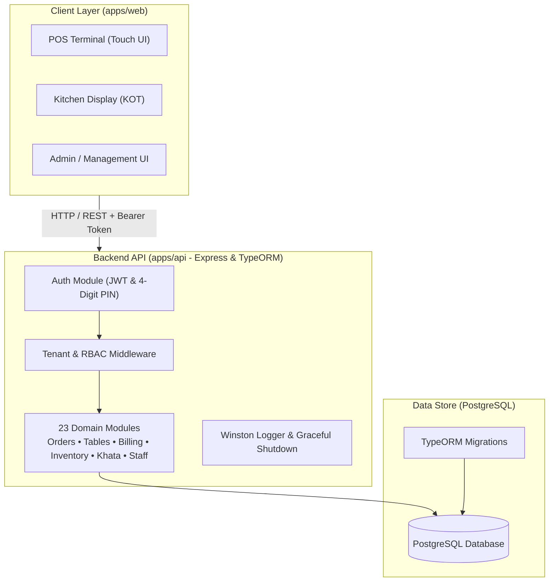

# ☕ ChiyaPasal POS & Management System

> **A production-ready, multi-tenant Restaurant & Cafe Management Platform designed for chiya pasals, tea shops, and restaurants in Nepal.**

[](https://www.typescriptlang.org/)
[](https://nodejs.org/)
[](https://react.dev/)
[](https://typeorm.io/)
[](https://www.postgresql.org/)
[](https://pm2.keymetrics.io/)

---

## 🌟 Key Features

### 1. ⚡ POS Terminal & Fast Staff Authentication
- **Multi-Mode Order Types**: Dine-In (table-based), Takeaway (counter/token), and Delivery.
- **Fast 4-Digit Staff PIN**: Waiters, cashiers, and kitchen crew log in instantly on touch screens via numeric keypad without typing passwords.
- **POS Staff Switcher**: Seamlessly switch the active cashier/server between tickets with a quick PIN punch.
- **Real-Time Cart**: Live VAT/tax computation, item discounts, customized kitchen notes (e.g. "कम चिनी", "less spicy").

### 2. 👨‍🍳 Kitchen Order Ticket (KOT) Display
- Separate real-time Kitchen Display System (KDS).
- Tracks individual item statuses: `NEW` ➔ `PREPARING` ➔ `READY` ➔ `SERVED`.
- Eliminates paper delays and reduces order mix-ups during peak rush hours.

### 3. 🪑 Interactive Table & Floor Management
- Visual floor plan supporting multiple areas: **Indoor Dining**, **Rooftop**, **Patio/Garden**.
- Color-coded live table states: `Available (Green)`, `Occupied (Red)`, `Reserved (Amber)`, `Cleaning (Blue)`.
- Seamless **Table Transfer / Merge**: Switch guest tickets between tables when customers relocate.

### 4. 💳 Flexible Billing & Payments
- **Cash Payments**: Real-time change calculator.
- **QR / Fonepay Payments**: Direct QR code scan recording with transaction reference.
- **Split Payments**: Settle one ticket across multiple payment methods (e.g., Rs. 500 Cash + Rs. 700 Fonepay).
- **Customer Khata (Credit) Settlement**: Charge directly to regular customer credit balance.

### 5. 📖 Customer Khata (Credit Ledger) & Loyalty
- Digital Nepali Khata ledger for trusted neighborhood customers.
- Real-time credit limits, outstanding balance tracking, partial payments, and settlement history.
- Automatic customer loyalty points accrued on every paid invoice.

### 6. 📦 Inventory & Recipe BOM (Bill of Materials)
- Raw ingredient tracking: milk, tea leaves, sugar, spices, flour, chicken, cooking oil.
- **Automatic Stock Deduction**: Selling a cup of "Special Masala Chiya" automatically deducts recipe ingredients (120ml Milk, 5g Tea Leaves, 8g Sugar).
- Low-stock reorder warnings, waste logs, supplier purchases, and operational expenses.

### 7. 👥 Staff & Role-Based Access Control (RBAC)
- Multi-branch employee roster with role badges (`Owner`, `Branch Manager`, `Cashier`, `Waiter`, `Kitchen Staff`).
- One-click employee activation/deactivation.
- Custom permission matrix guarding financial reports, refunds, and menu pricing.

---

## 🏗 System Architecture



---

## 🚀 Quick Start (Development)

### Prerequisites
- **Node.js**: v20.x or higher
- **PostgreSQL**: v14 or higher running on `localhost:5432`

### 1. Clone & Install
```bash
git clone https://github.com/your-org/chhiyapasal.git
cd chhiyapasal
npm install
```

### 2. Configure Environment
Copy the example environment file:
```bash
# In the root directory
cp .env.example .env

# And verify apps/api/.env
cp .env apps/api/.env
```

Ensure your PostgreSQL credentials in `.env` match your local setup:
```env
DB_HOST=localhost
DB_PORT=5432
DB_NAME=chhiyapasal
DB_USER=postgres
DB_PASSWORD=your_password
JWT_ACCESS_SECRET=chhiyapasal_super_secure_access_jwt_secret_key_2026
```

### 3. Run Migrations & Seed Sample Data
```bash
# Apply database schema
npm run migration:run

# Populate initial cafe, roles, tables, recipes, and staff
npm run seed
```

### 4. Start Development Servers
```bash
npm run dev
```
- **Web App**: [http://localhost:5173](http://localhost:5173)
- **API Server**: [http://localhost:4000/api/v1](http://localhost:4000/api/v1)
- **API Health**: [http://localhost:4000/health](http://localhost:4000/health)

---

## 🔐 Default Credentials & PINs

The initial seed creates ready-to-test accounts for every staff persona:

| Persona | Email | Password | 4-Digit POS PIN | Default Role |
|---|---|---|:---:|---|
| **Owner** | `admin@chhiyapasal.np` | `admin123` | **`0000`** | `OWNER` (Full Access) |
| **Cashier** | `cashier@chhiyapasal.np` | `admin123` | **`1111`** | `CASHIER` (POS & Billing) |
| **Kitchen Chef** | `kitchen@chhiyapasal.np` | `admin123` | **`2222`** | `KITCHEN_STAFF` (KOT Display) |
| **Waiter** | `waiter@chhiyapasal.np` | `admin123` | **`3333`** | `WAITER` (Floor Ordering) |

---

## 📁 Repository Structure

```
chhiyapasal/
├── apps/
│   ├── api/                     # Backend API (Express, TypeORM, TypeScript)
│   │   ├── src/
│   │   │   ├── aliases.ts       # Module alias loader for compiled dist
│   │   │   ├── config/env.ts    # Zod environment variable validator
│   │   │   ├── logger.ts        # Winston logger
│   │   │   ├── entities/        # 30+ TypeORM database entities
│   │   │   ├── database/        # Data-source, migrations, and seeds
│   │   │   ├── middleware/      # Auth, Tenant, RBAC, Validation, Error Handler
│   │   │   └── modules/         # Business domain modules (Order, Payment, Staff, etc.)
│   │   └── package.json
│   └── web/                     # Frontend Application (React, Vite, Tailwind CSS)
│       ├── src/
│       │   ├── api/client.ts    # Axios HTTP client with auth interceptors
│       │   ├── store/           # Zustand stores (pos.store, auth.store)
│       │   ├── pages/           # POS, Kitchen, Tables, Employees, Khata, etc.
│       │   └── components/      # Sidebar, modals, badges, layout
│       └── package.json
├── packages/
│   └── shared-types/            # Shared TypeScript contracts and enums
├── ecosystem.config.js          # PM2 cluster configuration
├── logs/                        # PM2 & Winston production logs
└── package.json                 # Monorepo scripts
```

---

## 📡 API Catalog Summary

All API endpoints are prefixed with `/api/v1` and require `Authorization: Bearer <token>` (except public auth endpoints).

| Module | Base Path | Description |
|---|---|---|
| **Auth** | `/auth` | Login (password / 4-digit PIN), token refresh, staff directory, register cafe |
| **Users / Staff** | `/users` | Staff CRUD, assign branch/role, toggle status, set POS PIN |
| **Roles** | `/roles` | Custom roles & granular permission management |
| **Branches** | `/branches` | Multi-branch locations management |
| **Tables** | `/tables`, `/table-areas` | Tables, status (`OCCUPIED`, `AVAILABLE`), floor areas |
| **Menu & Products**| `/categories`, `/products`| Menu items, tax rates, cost prices, categories |
| **Orders** | `/orders` | Create Dine-in/Takeaway/Delivery order, status history |
| **KOT** | `/kot` | Kitchen tickets, item preparation updates |
| **Invoices** | `/invoices` | Generate tax invoice, discount, cancellation |
| **Payments** | `/payments` | Settle bill via Cash, Fonepay/QR, Split, or Khata |
| **Khata (Credit)** | `/credit` | Customer credit balance, udharo ledger, settlements |
| **Customers** | `/customers`, `/loyalty` | Customer directory, loyalty point accrual and rules |
| **Inventory** | `/inventory`, `/recipes` | Stock levels, automatic recipe BOM deductions |
| **Procurement** | `/suppliers`, `/purchases`| Vendors, purchase bills, inventory restock |
| **Expenses** | `/expenses` | Daily operational expenses tracking |
| **Reports** | `/reports`, `/dashboard` | Daily sales, item performance, revenue analytics |

---

## 🛠 Production Deployment

### 1. Build Both Applications
```bash
npm run build
```
This runs `tsc` for the API and `tsc && vite build` for the frontend.

### 2. Configure Production `.env.production`
```bash
cp .env.production.example .env.production
```
Configure your production PostgreSQL database and production JWT secret.

### 3. Start with PM2
```bash
npm run start
```
PM2 will launch the server in the background using `ecosystem.config.js` with auto-restart on crashes and memory limits.

### 4. Useful Production Commands
```bash
npm run logs       # View real-time log output
npm run restart    # Zero-downtime application reload
npm run stop       # Stop the background process
```

---

## 📄 License
This project is proprietary software developed for restaurant and cafe operations in Nepal.
